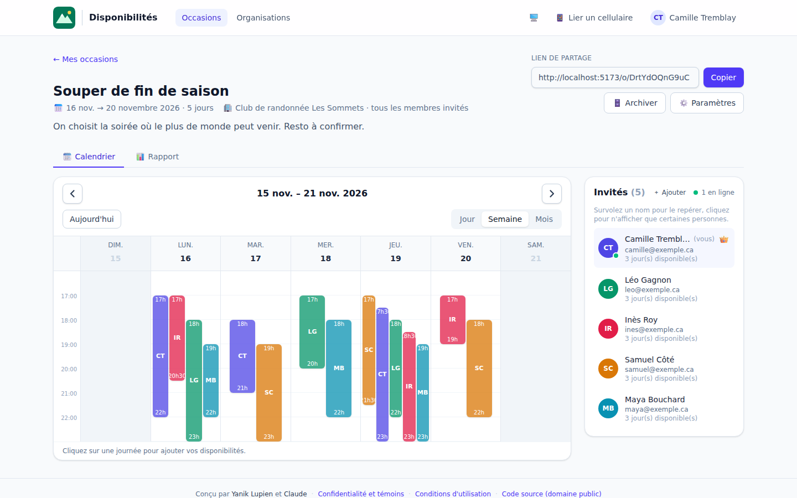
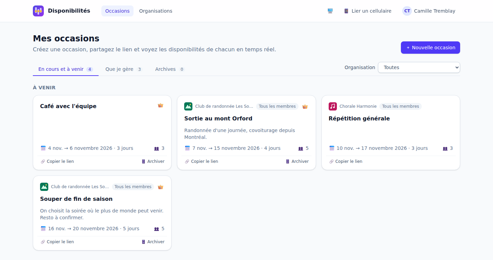
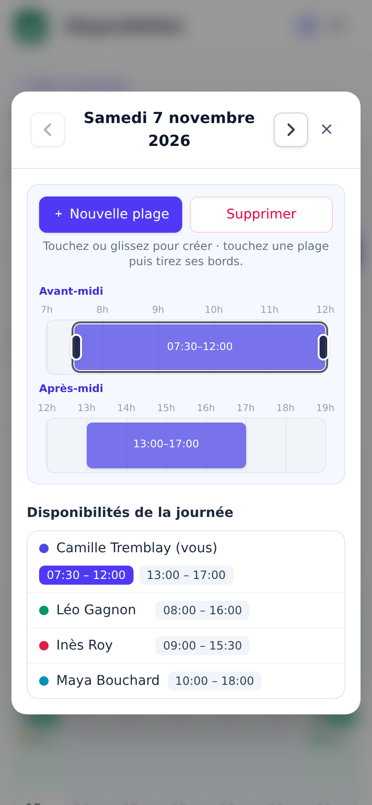

# Calendrier de disponibilités

Application web de planification de groupe, dans l'esprit de Doodle : on crée une **occasion**, on partage son
lien, et chaque invité indique ses **plages de disponibilité** sur un calendrier. Tout le monde voit les
disponibilités de tout le monde, **en temps réel**, et un **rapport** fait ressortir les moments où le plus de
personnes sont disponibles en même temps.

Aucun compte ni mot de passe : chaque visiteur est reconnu par un cookie permanent, et peut retrouver son
identité sur un autre appareil grâce à un code QR.

Interface en français. Stack : **Svelte 5 + Vite + Tailwind CSS 4** (frontend), **Node.js + Express 5 +
Socket.IO** (backend), **MySQL 8.4**, **Redis**, le tout sous **Docker Compose**. Code versé dans le
**domaine public** ([Unlicense](LICENSE)).

---

## Aperçu

*Captures réalisées avec des données de démonstration (personnes, organisations et occasions fictives).*

| Calendrier d'une occasion (vue Semaine) | Rapport : meilleurs moments (mode sombre) |
|---|---|
|  |  |

| Mes occasions | Éditeur de plages sur cellulaire |
|---|---|
|  |  |

---

## Sommaire

- [Aperçu](#aperçu)
- [Fonctionnalités](#fonctionnalités)
- [Démarrage rapide](#démarrage-rapide)
- [Architecture](#architecture)
- [Configuration](#configuration)
- [Fonctionnement détaillé](#fonctionnement-détaillé)
- [Temps réel](#temps-réel)
- [API REST](#api-rest)
- [Publication sur Internet (Cloudflare Tunnel)](#publication-sur-internet-cloudflare-tunnel)
- [Développement](#développement)
- [Structure du projet](#structure-du-projet)
- [Sécurité](#sécurité)
- [Confidentialité, conditions et licence](#confidentialité-conditions-et-licence)

---

## Fonctionnalités

**Occasions**
- Titre, description, **journées choisies une à une** dans un calendrier (clic, glisser, ou tout un jour de la semaine),
  **heures de la journée** (ex. 9 h → 22 h) et date de fin d'édition facultative. Le créateur peut ajouter ou retirer
  des journées ensuite ; retirer une journée supprime ses plages.
- Lien de partage : l'ouvrir associe automatiquement le visiteur à l'occasion.
- Liste « Mes occasions » avec onglets *En cours et à venir* / *Que je gère* / *Archives* et filtre par organisation.
  Une couronne 👑 signale les occasions que l'on gère (créées par soi, ou d'une organisation que l'on administre).
- Archivage automatique après la dernière journée, ou manuel par le créateur (annulable tant qu'elle n'est pas passée).
  Une occasion archivée ou dont l'édition est fermée est en lecture seule.

**Calendrier et plages**
- Vues **Jour**, **Semaine** et **Mois** (semaines du dimanche au samedi). Seules les journées choisies sont ouvertes,
  les autres sont grisées ; dans l'éditeur, ‹ › passent d'une journée choisie à la suivante.
- En vues Jour et Semaine, chaque plage est une barre étroite : heure de début en haut, initiales de la personne au
  milieu, heure de fin en bas.
- Un clic sur une journée ouvre l'éditeur de plages :
  - **ordinateur** : timeline horizontale ; cliquer ou glisser pour créer, déplacer ou étirer une plage, la glisser hors de la ligne pour la supprimer ;
  - **cellulaire** : deux lignes, *avant-midi* et *après-midi*, pour voir toute la journée d'un coup ; toucher ou glisser
    pour créer, poignées pour redimensionner, glisser pour déplacer (même d'une ligne à l'autre). « Nouvelle plage »
    ouvre une petite fenêtre (heures de début et de fin, ajouts rapides).
- Plusieurs plages par jour, sans chevauchement (deux plages bout à bout sont fusionnées). Pas de 15 minutes.
- Sur ordinateur : champs d'heure liés à la plage sélectionnée, ajouts rapides (Matin, Après-midi, Soirée, Journée).

**Rapport**
- Carte de chaleur de toutes les plages superposées : plus la couleur est foncée, plus il y a de monde disponible ;
  le pourcentage s'affiche dans les zones les plus foncées.
- « Meilleurs moments » (top 5), liés par survol à la carte de chaleur ; un clic ouvre la journée.

**Personnes**
- Nom demandé une seule fois (courriel facultatif) ; la personne apparaît dans la liste des invités, visible de tous.
- Liste des invités : survoler un nom grise les plages des autres dans le calendrier ; cliquer sur des noms (icône 👁)
  n'affiche temporairement que ces personnes (« Tout afficher » pour revenir).
- Présence en direct : qui est en ligne, qui modifie quelle journée (la plage bouge chez les autres pendant qu'on la déplace).
- Le créateur d'une occasion (ou un admin de son organisation) peut **retirer** ou **ajouter** des invités.

**Organisations**
- Nom, logo (affiché en haut des pages de ses occasions) et responsable.
- Ouvrir le lien d'une occasion d'une organisation en rend membre automatiquement.
- *Mode libre* : tous les membres créent des occasions. *Mode autorisé* : seuls les membres cochés.
- Rôle **administrateur** : gère l'organisation (membres, droits, logo) et les invités de ses occasions.
- À la création d'une occasion, « **Tous les membres** » l'associe à tous les membres, actuels et futurs.

**Multi-appareils**
- Bouton 📱 : un code QR à usage unique (10 min) lie le cellulaire à la même identité.
  Si le cellulaire avait déjà un compte, il propose de **fusionner** les deux comptes.

**Interface**
- Adaptée au cellulaire (menu compact, éditeur tactile) et à l'ordinateur.
- **Mode sombre** : suit le thème de l'appareil par défaut ; bouton ☀️ / 🌙 / 🖥️ pour forcer clair ou sombre (mémorisé).
- Quand une fenêtre est ouverte, la page derrière ne défile plus.

---

## Démarrage rapide

Prérequis : Docker et Docker Compose.

```bash
cp .env.example .env          # facultatif : des valeurs par défaut sont prévues
docker compose up -d --build
```

Ouvrir **http://localhost:5173**.

Le schéma de la base est créé (et mis à jour) automatiquement au démarrage du backend.

---

## Architecture

```
 Navigateur ──► frontend (Vite, :5173) ──proxy /api, /socket.io──► backend (Node, :3000) ──► db (MySQL)
                                                                         │
 Internet ──► Cloudflare ──► tunnel (cloudflared) ──► web (Node, prod) ──┤
                                                                         └──► redis (temps réel partagé)
```

| Service    | Rôle |
|------------|------|
| `frontend` | Serveur de développement Vite (Svelte 5 + Tailwind 4). Relaie `/api` et `/socket.io` vers le backend. |
| `backend`  | API REST (Express 5), cookie d'identification, serveur Socket.IO. Rechargé à chaque modification. |
| `db`       | MySQL 8.4 : utilisateurs, occasions, participants, plages, organisations. |
| `redis`    | Relie le temps réel des serveurs de développement et de production (adaptateur Socket.IO). |
| `web`      | *Profil `public`* — image de production : frontend compilé servi par le backend. |
| `tunnel`   | *Profil `public`* — `cloudflared`, publie `web` sur Internet. |

Tous les services ont `restart: unless-stopped` : ils repartent seuls après un redémarrage de la machine
(dès que Docker démarre), sauf s'ils ont été arrêtés volontairement.

---

## Configuration

Variables du fichier `.env` (modèle : `.env.example`) :

| Variable | Défaut | Description |
|----------|--------|-------------|
| `APP_PORT` | `5173` | Port local du serveur de développement. |
| `APP_TIMEZONE` | `America/Toronto` | Fuseau utilisé pour « aujourd'hui » (archivage) et les dates limites d'édition. |
| `DB_NAME`, `DB_USER`, `DB_PASSWORD`, `DB_ROOT_PASSWORD` | `calendar` / `root` | Accès MySQL. **À changer** pour un usage réel. |
| `DB_PUBLIC_PORT` | `3307` | Port MySQL exposé sur la machine (outils d'administration). |
| `COOKIE_SECURE` | `false` | Cookie `Secure` pour le serveur de développement (le service `web` l'active toujours). |
| `PUBLIC_HOSTNAME` | — | Adresse publique (ex. `disponibilites.example.com`) : publication et codes QR. |
| `TUNNEL_NAME` | `disponibilites` | Nom du tunnel Cloudflare. |
| `WEB_PORT` | `8090` | Port local (127.0.0.1) du service de production. |
| `COMPOSE_PROFILES` | — | `public` pour que `docker compose up -d` démarre aussi `web` et `tunnel`. |

---

## Fonctionnement détaillé

### Identification sans compte
- À la première visite, `GET /api/me` crée un utilisateur et pose le cookie `rc_uid` (httpOnly, expiration en 9999).
  Les navigateurs plafonnant la durée des cookies (400 jours pour Chrome), il est réémis à chaque appel : il
  n'expire pas tant que la personne revient.
- **Lier un appareil** : l'ordinateur génère un jeton aléatoire (stocké sous forme d'empreinte SHA-256, valable
  10 minutes, utilisable une fois) affiché en code QR. Le cellulaire qui l'ouvre reçoit le cookie de la même personne.
  Fusion : participations, plages (celles de l'ordinateur gagnent en cas de doublon le même jour), occasions créées
  et organisations sont rattachées au compte de l'ordinateur ; l'ancien compte est supprimé.

### Règles
- **Journées** : au moins une, aucune dans le passé à l'ajout ; stockées dans la table `occasion_days`.
- **Plages** : sur une journée choisie, dans les heures de l'occasion, sans chevauchement pour une même personne.
- **Lecture seule** : occasion archivée, ou date de fin d'édition dépassée.
- **Retrait** : un invité ou un membre retiré n'est pas réintégré en rouvrant un lien ; seul un responsable,
  un admin ou le créateur peut le réintégrer.
- Toutes les règles sont vérifiées par le serveur, pas seulement par l'interface.

### Droits

| Action | Qui |
|--------|-----|
| Modifier / archiver une occasion | Son créateur |
| Retirer / ajouter des invités | Le créateur, ou un admin de l'organisation de l'occasion |
| Créer une occasion dans une organisation | Responsable, admins ; tous les membres en mode libre ; membres cochés en mode autorisé |
| Gérer une organisation (membres, droits, logo, mode) | Responsable et admins |
| Supprimer une organisation | Le responsable |

---

## Temps réel

Socket.IO, une salle par occasion. Les modifications passent par l'API REST, qui diffuse ensuite l'événement.
Avec `REDIS_URL`, plusieurs serveurs (développement et production) partagent leurs événements ; la présence est
calculée sur les connexions de tous les serveurs.

| Événement | Sens | Contenu |
|-----------|------|---------|
| `occasion:join` / `occasion:leave` | client → serveur | `slug` (accusé : `{ ok, presence }`) |
| `editing` | client → serveur | `{ day, start, end, slotId?, deleting? }` ou `null` |
| `presence` | serveur → clients | `{ online: [userId], editing: [{ userId, day, start, end, slotId, deleting }] }` |
| `slots:day` | serveur → clients | `{ userId, day, slots }` — remplace les plages de ce jour pour cette personne |
| `participant:upsert` | serveur → clients | `{ id, name, email }` |
| `participant:removed` | serveur → clients | `{ userId }` |
| `occasion:updated` | serveur → clients | occasion |

---

## API REST

Préfixe `/api`. Toutes les routes identifient le visiteur par son cookie. Les heures sont en minutes depuis minuit.

| Méthode | Route | Description |
|---------|-------|-------------|
| GET / PUT | `/me` | Profil (nom, courriel) |
| GET / POST | `/occasions` | Mes occasions / créer `{ title, days: ['YYYY-MM-DD', …], dayStart, dayEnd, … }` |
| GET / PATCH | `/occasions/:slug` | Détail avec `days` (rejoint l'occasion) / paramètres (dont `days`) |
| POST | `/occasions/:slug/archive` | Archiver `{ archived }` |
| POST · PATCH · DELETE | `/occasions/:slug/slots[/:id]` | Plages : ajouter `{ day, start, end }`, modifier, supprimer |
| GET | `/occasions/:slug/candidates` | Personnes ajoutables comme invités |
| POST · DELETE | `/occasions/:slug/participants[/:userId]` | Ajouter `{ userIds }` / retirer un invité |
| GET / POST | `/organizations` | Mes organisations / créer |
| GET · PATCH · DELETE | `/organizations/:id` | Détail (membres pour les gestionnaires) / modifier / supprimer |
| PUT · DELETE | `/organizations/:id/members/:userId` | Droits `{ canCreate, isAdmin }` / retirer |
| POST | `/organizations/:id/members/:userId/restore` | Réintégrer un membre |
| GET · PUT · DELETE | `/organizations/:id/logo` | Logo (PNG, JPEG, WebP, GIF, SVG ; 2 Mo) |
| POST | `/link` | Créer un code QR de liaison |
| GET | `/link/:id/status` | Le code a-t-il été utilisé ? |
| GET | `/link/preview/:token` | Comptes concernés (avant confirmation) |
| POST | `/link/claim` | Lier l'appareil `{ token, merge }` |

---

## Publication sur Internet (Cloudflare Tunnel)

Le service `tunnel` (image officielle `cloudflare/cloudflared`) ouvre une connexion **sortante** vers Cloudflare :
aucun port n'est ouvert sur la machine ni sur le routeur, HTTPS et WebSocket sont gérés par Cloudflare. Il publie le
service `web` (production) ; le serveur de développement Vite n'est jamais exposé.

Prérequis : `cloudflared` installé et connecté au compte (`cloudflared tunnel login`), `jq`, et un domaine géré par Cloudflare.

```bash
# .env : PUBLIC_HOSTNAME=disponibilites.example.com
scripts/web.sh publish   # une seule fois : tunnel + DNS, active le profil « public », démarre
docker compose up -d     # ensuite : démarre aussi web + tunnel
scripts/web.sh status    # état des conteneurs, du tunnel et du site
scripts/web.sh stop      # retire le site public (le développement continue)
scripts/web.sh logs      # journaux du tunnel
```

Les identifiants du tunnel sont écrits dans `deploy/cloudflared/` (mode 600, hors Git).
Après une modification du code, reconstruire la production : `docker compose up -d --build web`.

---

## Développement

- `backend/src` et `frontend/src` sont montés dans les conteneurs : rechargement automatique (`node --watch`, HMR Vite).
- Après l'ajout d'une dépendance npm, reconstruire le conteneur concerné : `docker compose up -d --build frontend` (ou `backend`).
- Accès MySQL : `localhost:3307` (identifiants du `.env`).
- Réinitialiser la base : `docker compose down -v`.
- Journaux : `docker compose logs -f backend`.

---

## Structure du projet

```
.
├── docker-compose.yml        services (développement, Redis, production, tunnel)
├── Dockerfile                image de production (frontend compilé + backend)
├── scripts/web.sh            publication Cloudflare Tunnel
├── docs/captures/            captures d'écran du README
├── LICENSE                   domaine public (Unlicense)
├── backend/
│   └── src/
│       ├── index.js          serveur HTTP, en-têtes de sécurité, fichiers statiques
│       ├── db.js             connexion MySQL et migrations
│       ├── auth.js           cookie d'identification
│       ├── routes.js         occasions, plages, invités, archives
│       ├── organizations.js  organisations, membres, rôles, logos
│       ├── link.js           liaison d'appareils par code QR, fusion de comptes
│       ├── socket.js         temps réel et présence (adaptateur Redis)
│       └── clock.js          date et heure dans le fuseau de l'application
└── frontend/
    └── src/
        ├── App.svelte        en-tête, menu, routage
        ├── pages/            Home, Occasion, Organizations, LinkClaim, Privacy, Terms
        ├── components/       calendrier (Calendar, MonthView, TimeGrid, DayOverlay), Report,
        │                     GuestList, éditeurs d'occasion et d'organisation, LinkDevice…
        └── lib/              API, dates, socket, routeur, session, thème, verrouillage du défilement
```

---

## Sécurité

- Cookie `httpOnly`, `SameSite=Lax`, `Secure` en production.
- Jetons de liaison stockés sous forme d'empreinte, courte durée de vie, usage unique.
- Logos : type et signature vérifiés ; servis avec `nosniff` et une politique CSP `sandbox` (un SVG ne peut pas exécuter de script).
- Conteneurs `web`, `tunnel` et `redis` verrouillés : système de fichiers en lecture seule, aucune capacité Linux,
  `no-new-privileges`, mémoire limitée. Le port de `web` n'est publié que sur `127.0.0.1`.
- Les fichiers sensibles (`.env`, `deploy/`) sont exclus de Git.
- Les mots de passe MySQL par défaut sont destinés au développement : changez-les dans `.env`.

---

## Confidentialité, conditions et licence

- Pages **Confidentialité et témoins** (`/confidentialite`) et **Conditions d'utilisation** (`/conditions`), liées dans le
  pied de page. Elles suivent la loi québécoise sur la protection des renseignements personnels (Loi 25) : un seul témoin,
  essentiel (`rc_uid`), aucun pistage ; renseignements recueillis, finalités, destinataires, prestataire (Cloudflare),
  conservation et droits.
- Le responsable de la protection des renseignements personnels se configure dans `.env` :
  `LEGAL_CONTACT_NAME`, `LEGAL_CONTACT_EMAIL` (affichés sur ces pages).
- **Licence** : domaine public ([Unlicense](LICENSE)).

