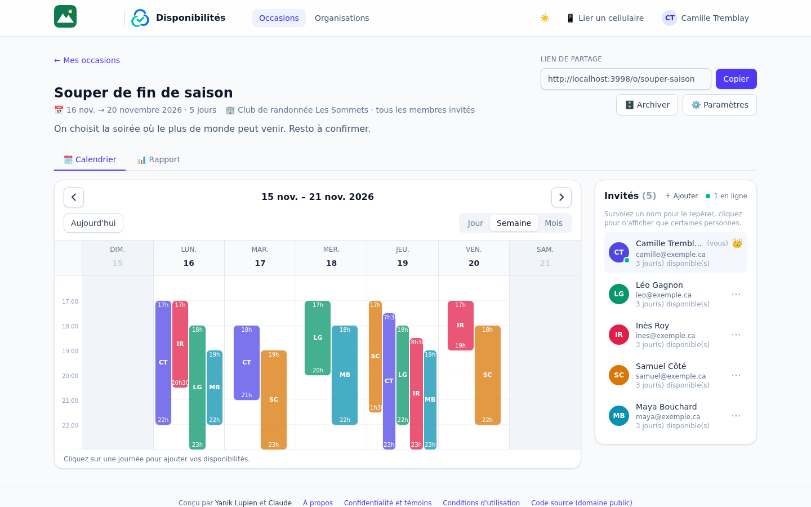
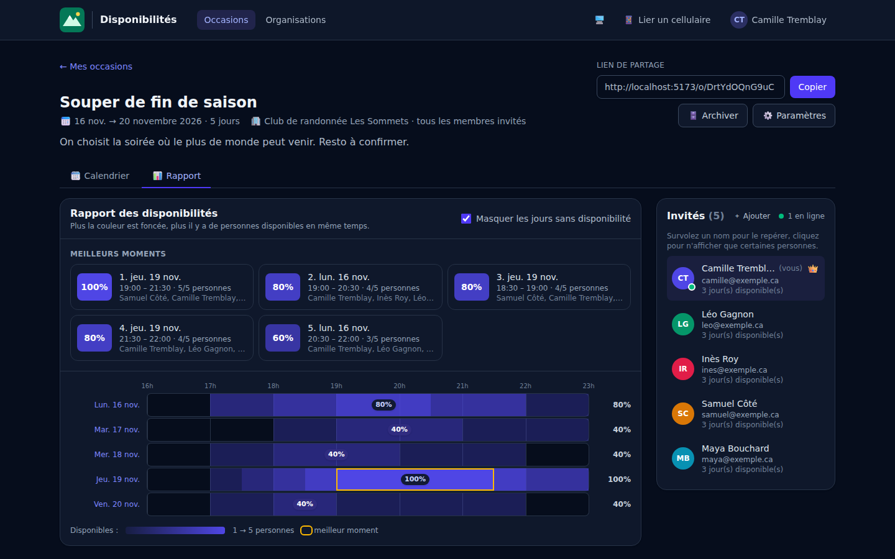
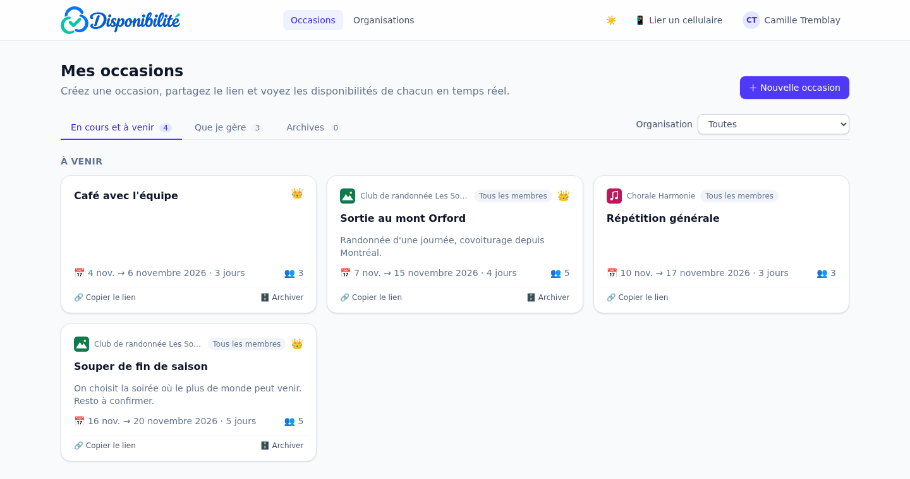
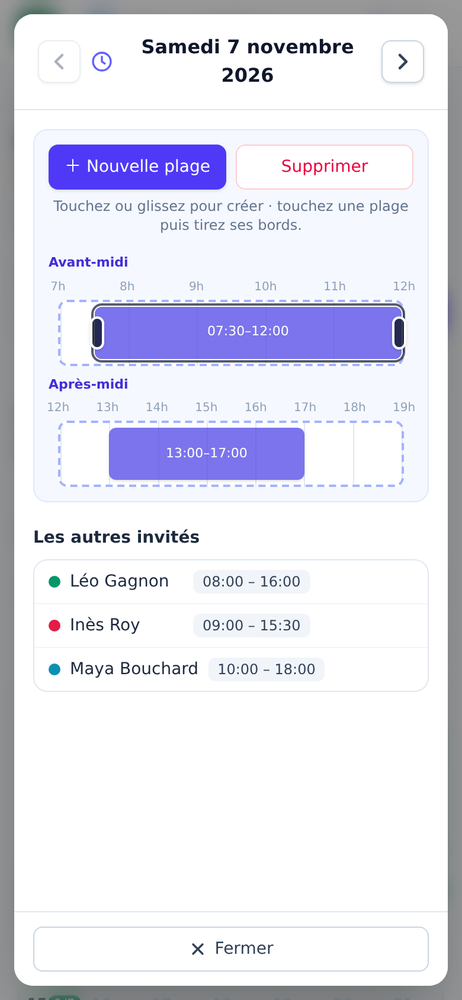

# Calendrier de disponibilités

Application web de planification de groupe, dans l'esprit de Doodle : on crée une **occasion**, on partage son
lien, et chaque invité indique ses **plages de disponibilité** sur un calendrier. Tout le monde voit les
disponibilités de tout le monde, **en temps réel**, et un **rapport** fait ressortir les moments où le plus de
personnes sont disponibles en même temps.

Pas d'inscription : chaque visiteur est reconnu par un cookie permanent, et peut retrouver son identité sur un
autre appareil grâce à un code QR, un mot de passe facultatif ou un lien de connexion reçu par courriel. L'accès
se fait **sur invitation** : le cookie n'est créé qu'en ouvrant le lien d'une occasion.

Interface en français. Stack : **Svelte 5 + Vite + Tailwind CSS 4** (frontend), **Node.js + Express 5 +
Socket.IO** (backend), **MySQL 8.4**, **Redis**, le tout sous **Docker Compose**. Code versé dans le
**domaine public** ([Unlicense](LICENSE)).

---

## Aperçu

*Captures réalisées avec des données de démonstration (personnes, organisations et occasions fictives).*

| Calendrier d'une occasion (vue Semaine) | Rapport : meilleurs moments (mode sombre) |
|---|---|
|  |  |

| Mes occasions | Éditeur de plages sur cellulaire |
|---|---|
|  |  |

---

## Sommaire

- [Aperçu](#aperçu)
- [Fonctionnalités](#fonctionnalités)
- [Démarrage rapide](#démarrage-rapide)
- [Configuration](#configuration)
- [Documentation technique](#documentation-technique)
- [Confidentialité, conditions et licence](#confidentialité-conditions-et-licence)

---

## Fonctionnalités

**Occasions**
- Titre, description, **journées choisies une à une** dans un calendrier (clic, glisser, ou tout un jour de la semaine),
  **heures de la journée** (ex. 9 h → 22 h) et date de fin d'édition facultative. Le créateur peut ajouter ou retirer
  des journées ensuite ; retirer une journée supprime ses plages.
- Lien de partage : l'ouvrir associe automatiquement le visiteur à l'occasion.
- Liste « Mes occasions » avec onglets *En cours et à venir* / *Que je gère* / *Archives* et filtre par organisation.
  Une couronne 👑 signale les occasions que l'on gère (créées par soi, ou d'une organisation que l'on administre).
- Archivage automatique après la dernière journée, ou manuel par le créateur (annulable tant qu'elle n'est pas passée).
  Une occasion archivée ou dont l'édition est fermée est en lecture seule.

**Calendrier et plages**
- Vues **Jour**, **Semaine** et **Mois** (semaines du dimanche au samedi). Seules les journées choisies sont ouvertes,
  les autres sont grisées ; dans l'éditeur, ‹ › passent d'une journée choisie à la suivante.
- En vues Jour et Semaine, chaque plage est une barre étroite : heure de début en haut, initiales de la personne au
  milieu, heure de fin en bas.
- Un clic sur une journée ouvre l'éditeur de plages :
  - **ordinateur** : timeline horizontale (ma ligne, en pointillé, est la seule où l'on dessine) ; cliquer ou glisser
    pour créer, déplacer ou étirer une plage, la glisser hors de la ligne pour la supprimer. Les lignes des autres
    invités sont affichées en dessous, alignées sur les mêmes heures ;
  - **cellulaire** : deux lignes, *avant-midi* et *après-midi*, pour voir toute la journée d'un coup ; toucher ou glisser
    pour créer, poignées pour redimensionner, glisser pour déplacer (même d'une ligne à l'autre). Les plages des autres
    invités sont listées en dessous.
- « Nouvelle plage » ouvre une petite fenêtre (heures de début et de fin, ajouts rapides : Matin, Après-midi, Soirée,
  Journée). L'en-tête de l'éditeur et le bouton Fermer restent visibles pendant le défilement.
- Plusieurs plages par jour, sans chevauchement (deux plages bout à bout sont fusionnées). Pas de 15 minutes.

**Rapport**
- Carte de chaleur de toutes les plages superposées : plus la couleur est foncée, plus il y a de monde disponible ;
  le pourcentage s'affiche dans les zones les plus foncées.
- « Meilleurs moments » (top 5), liés par survol à la carte de chaleur ; un clic ouvre la journée.

**Personnes**
- Nom demandé une seule fois (courriel facultatif) ; la personne apparaît dans la liste des invités, visible de tous.
  La fenêtre « Bienvenue ! » propose de **se connecter** à un compte existant, et avertit quand le nom tapé est déjà
  celui d'un invité de l'occasion (pour éviter les comptes en double).
- Liste des invités : survoler un nom grise les plages des autres dans le calendrier ; cliquer sur des noms (icône 👁)
  n'affiche temporairement que ces personnes (« Tout afficher » pour revenir).
- Présence en direct : qui est en ligne, qui modifie quelle journée (la plage bouge chez les autres pendant qu'on la déplace).
- Le créateur d'une occasion (ou un admin de son organisation) peut **retirer** ou **ajouter** des invités.

**Organisations**
- Nom, logo (affiché en haut des pages de ses occasions, agrandissable d'un clic) et responsable.
- Ouvrir le lien d'une occasion d'une organisation en rend membre automatiquement.
- *Mode libre* : tous les membres créent des occasions. *Mode autorisé* : seuls les membres cochés.
- Rôle **administrateur** : gère l'organisation (membres, droits, logo) et les invités de ses occasions.
- À la création d'une occasion, « **Tous les membres** » l'associe à tous les membres, actuels et futurs.

**Comptes et appareils**
- Bouton 📱 : un code QR à usage unique (10 min) lie le cellulaire à la même identité.
  Si le cellulaire avait déjà un compte, il propose de **fusionner** les deux comptes.
- **Mot de passe** facultatif, choisi dans « Mon profil » : on se reconnecte à `/connexion` avec son courriel.
- **Lien de connexion par courriel** (sans mot de passe), à usage unique, valide 30 minutes ; il ramène à la page
  d'où l'on venait.

**Administration du site**
- Page **Administration** (onglets Comptes, Organisations, Occasions) réservée à l'administrateur du site :
  créer un compte déjà associé à des organisations et occasions, définir courriel et mot de passe, créer un lien
  de connexion (7 jours), fusionner des comptes en double, supprimer comptes, occasions et organisations.
- L'administrateur gère toutes les organisations et occasions depuis leurs propres pages, sans y être ajouté.

**Interface**
- Adaptée au cellulaire (menu compact, éditeur tactile) et à l'ordinateur.
- **Mode sombre** : suit le thème de l'appareil par défaut ; bouton ☀️ / 🌙 / 🖥️ pour forcer clair ou sombre (mémorisé).
- Quand une fenêtre est ouverte, la page derrière ne défile plus.
- Les onglets ont leur adresse (`#calendrier`, `#rapport`, `/admin/comptes`, `/admin/organisations/<numéro>`…) : un rechargement garde l'onglet, et « ← » ou Précédent ramène à la liste.

---

## Démarrage rapide

Prérequis : Docker et Docker Compose.

```bash
cp .env.example .env          # facultatif : des valeurs par défaut sont prévues
docker compose up -d --build
scripts/dev-db.sh create      # base du serveur de développement (calendar_dev)
docker compose restart backend
```

Ouvrir **http://localhost:5173**. Le schéma de la base est créé (et mis à jour) automatiquement au démarrage du
backend. Pour entrer dans l'application, ouvrir le lien d'une occasion : l'accès se fait sur invitation.

Ensuite, selon les besoins :

- **Administrateur du site** : `docker compose exec backend node src/cli.js admin <courriel ou numéro de compte>`
  (`web` au lieu de `backend` pour la production) — voir [Comptes et administration](docs/comptes.md).
- **Liens de connexion par courriel** : renseigner `RESEND_API_KEY` et `MAIL_FROM` (voir [Configuration](#configuration)).
- **Publication sur Internet** (Cloudflare Tunnel) : voir [Publication](docs/deploiement.md).
- **Copie des données de production** dans la base de développement : `scripts/dev-db.sh copy`.

---

## Configuration

Variables du fichier `.env` (modèle : `.env.example`) :

| Variable | Défaut | Description |
|----------|--------|-------------|
| `APP_PORT` | `5173` | Port local du serveur de développement. |
| `APP_TIMEZONE` | `America/Toronto` | Fuseau utilisé pour « aujourd'hui » (archivage) et les dates limites d'édition. |
| `DB_NAME`, `DB_USER`, `DB_PASSWORD`, `DB_ROOT_PASSWORD` | `calendar` / `root` | Accès MySQL. **À changer** pour un usage réel. |
| `DEV_DB_NAME` | `calendar_dev` | Base du serveur de développement (voir [Développement](docs/developpement.md)). |
| `DB_PUBLIC_PORT` | `3307` | Port MySQL exposé sur la machine (outils d'administration). |
| `COOKIE_SECURE` | `false` | Cookie `Secure` pour le serveur de développement (le service `web` l'active toujours). |
| `PUBLIC_HOSTNAME` | — | Adresse publique (ex. `disponibilites.example.com`) : publication et codes QR. |
| `TUNNEL_NAME` | `disponibilites` | Nom du tunnel Cloudflare. |
| `WEB_PORT` | `8090` | Port local (127.0.0.1) du service de production. |
| `COMPOSE_PROFILES` | — | `public` pour que `docker compose up -d` démarre aussi `web` et `tunnel`. |
| `HOST_UID`, `HOST_GID` | `1000` | Utilisateur du conteneur `tunnel`, propriétaire de `deploy/cloudflared/` ; remplis par `scripts/web.sh`, à indiquer si `id -u` n'est pas 1000. |
| `LEGAL_CONTACT_NAME`, `LEGAL_CONTACT_EMAIL` | — | Responsable de la protection des renseignements personnels (pages Confidentialité et Conditions). |
| `RESEND_API_KEY` | — | Clé du service [Resend](https://resend.com) : envoi des liens de connexion par courriel. Sans elle, cette option est désactivée. |
| `MAIL_FROM` | `Disponibilités <onboarding@resend.dev>` | Expéditeur des courriels, sur un domaine vérifié dans Resend (l'adresse par défaut n'écrit qu'au titulaire du compte Resend). |

---

## Documentation technique

Le fonctionnement interne est documenté dans [`docs/`](docs/README.md) :
[architecture](docs/architecture.md) ·
[fonctionnement détaillé](docs/fonctionnement.md) ·
[comptes et administration](docs/comptes.md) ·
[temps réel](docs/temps-reel.md) ·
[API REST](docs/api.md) ·
[publication](docs/deploiement.md) ·
[développement](docs/developpement.md) ·
[sécurité](docs/securite.md).

---

## Confidentialité, conditions et licence

- Pages **Confidentialité et témoins** (`/confidentialite`) et **Conditions d'utilisation** (`/conditions`), liées dans le
  pied de page. Elles suivent la loi québécoise sur la protection des renseignements personnels (Loi 25) : un seul témoin,
  essentiel (`rc_uid`), aucun pistage ; renseignements recueillis, finalités, destinataires, prestataire (Cloudflare),
  conservation et droits.
- Le responsable de la protection des renseignements personnels se configure dans `.env` :
  `LEGAL_CONTACT_NAME`, `LEGAL_CONTACT_EMAIL` (affichés sur ces pages).
- **Licence** : domaine public ([Unlicense](LICENSE)).
